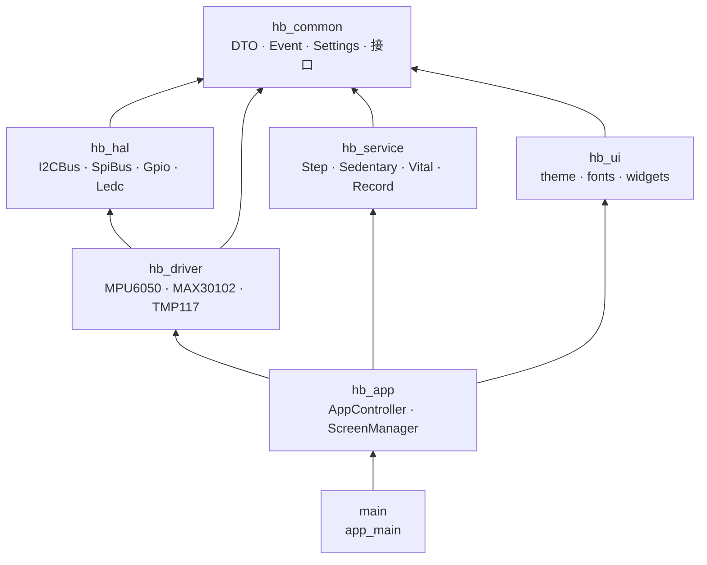
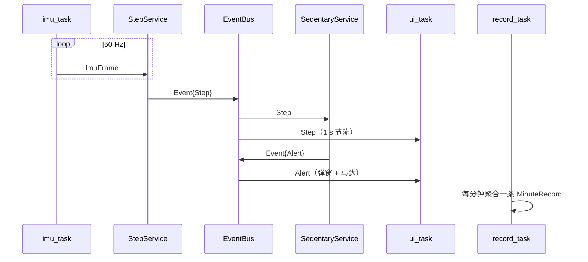
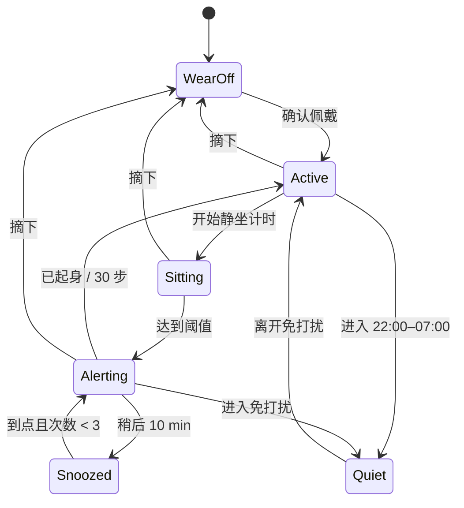

# 架构设计

本文档回答三个问题：**系统由哪些层组成、数据怎么流动、为什么这样分层**。
需求与课程安排见 `README.md`，接线见 `docs/pinout.md`，协议见 `docs/protocol.md`。

---

## 1. 分层视图

箭头表示“依赖”。`hb_service` 只依赖 `hb_common`，所以它能在 PC 上编译、跑单测，不需要 FreeRTOS 与 ESP-IDF。

### 组件职责

| 组件 | 放什么 | 不放什么 |
| --- | --- | --- |
| `hb_common` | `ImuFrame`、`PpgSample`、`MinuteRecord`、`Event`、`Settings`、`IClock`、`IRecordStore` | 任何 `esp_*`、`lv_*` |
| `hb_hal` | I2C 总线单例、SPI、GPIO、PWM、NVS 封装 | 器件寄存器、业务判断 |
| `hb_driver` | 具体器件的初始化、量纲转换、FIFO 读取 | LVGL、业务状态机 |
| `hb_service` | 计步、久坐、PPG、记录、同步 | GPIO、`lv_*`、具体驱动类 |
| `hb_ui` | 主题、字体、通用控件 | 业务逻辑 |
| `hb_app` | 页面栈、事件路由、组件装配 | 寄存器操作 |

### 三条硬规则

1. `hb_ui` 不出现 `i2c_`、`esp_`。
2. `hb_driver` 不出现 `lv_`。
3. `hb_service` 不 include `driver/`，不直接操作 GPIO。

由 `tools/check_layers.py` 做静态检查，GitHub Actions 与本地提交前都应通过。

---

## 2. 运行时设计（目标形态）

> 当前骨架只实现了同步调用的 `StepService` / `SedentaryService`，
> 任务与队列在 P2 接入，下表是目标值，不是现状。

| 任务 | 优先级 | 核心 | 栈 | 周期 | 职责 |
| --- | --- | --- | --- | --- | --- |
| `imu_task` | 5 | 1 | 6 KB | 20 ms | 读 MPU6050，发布 `ImuFrame` |
| `ppg_task` | 4 | 1 | 6 KB | 10 ms | 读 FIFO，发布 `PpgSample` |
| `temp_task` | 2 | 1 | 4 KB | 1 s | 读 TMP117，滑动平均 |
| `ui_task` | 3 | 0 | 8 KB | 16–33 ms | LVGL 事务、页面刷新 |
| `record_task` | 1 | 0 | 4 KB | 60 s | 聚合记录、写 LittleFS |
| `sync_task` | 2 | 0 | 6 KB | 5 min | Wi-Fi 同步、游标 |
| `button_task` | 3 | 0 | 3 KB | 10 ms | 消抖、短按/长按 |

并发约束：

- 中断里不调用 LVGL、不动态分配内存；
- 持有 I2C 锁时不等队列/信号量；
- UI 任务里不做阻塞式文件写入；
- 跨任务只传值或小结构体，不传指针。

---

## 3. 数据流

要点：

- 采集与算法分离，队列削峰；
- UI 刷新节流到 1 s，50 Hz 直接刷屏会闪烁；
- 马达震动期间与之后 300 ms 暂停计步，避免“自己把自己震出一步”。

---

## 4. 久坐状态机

| 状态 | 含义 | 界面 |
| --- | --- | --- |
| `WearOff` | 未佩戴，停止计时 | 表盘提示“未佩戴” |
| `Active` | 佩戴且活动正常 | 久坐页显示 0 |
| `Sitting` | 正在累计久坐分钟 | 倒计时/圆弧 |
| `Alerting` | 已触发提醒，等待处理 | 全屏弹窗 + 马达 |
| `Snoozed` | 用户选择稍后 | 倒计时 10 min |
| `Quiet` | 免打扰时段，只计时不提醒 | 显示“明早提醒” |

规则细节：

- 有效活动 = 5 min 内步数 ≥ 30 或达到中等活动强度；
- 稍后最多 3 次，超过后只保留“已起身”；
- 提醒 60 s 无操作自动视为“稍后”；
- 计时用单调时钟，改系统时间不能绕过提醒。

---

## 5. 存储与协议

- 设置、游标、校准参数 → NVS；
- 分钟记录 → LittleFS，按天分文件，16 字节定长；
- 同步 → TCP + JSON Lines，`(deviceId, ts)` 幂等。

字段定义见 `docs/protocol.md`。

---

## 6. 关键决策（ADR）

### ADR-001 双构建，而不是两套工程

- **决定**：根 `CMakeLists.txt` 用 `TASK_HOST` 分流；主机模式编译 `hb_common` + `hb_service` + `tests/host`。
- **理由**：算法调参需要秒级反馈；两套工程必然不同步。
- **代价**：`hb_service` 必须保持“无 IDF 依赖”，日志、时钟都要走接口。

### ADR-002 组件统一加 `hb_` 前缀

- **决定**：目录名 `hb_hal`、`hb_driver` 等。
- **理由**：ESP-IDF 已有 `hal`、`driver` 组件，同名会遮蔽官方组件，`driver/i2c_master.h` 会直接找不到。
- **代价**：目录名比逻辑层名长，但 include 路径仍是 `hal/i2c_bus.h`。

### ADR-003 增加 `hb_common`

- **决定**：DTO、事件、设置、接口放独立组件。
- **理由**：让 `hb_service` 可以脱离硬件编译；否则单测跑不起来。
- **代价**：多一层目录；禁止把业务逻辑塞进 `common`。

### ADR-004 显示/触摸做接口，后端二选一

- **决定**：`DisplayDriver` / `TouchDriver` 抽象，SPI 与 RGB 各一个后端。
- **理由**：文档写 SPI + FT6236，实物资料是 RGB + GT9xxx，先抽象再定后端，避免 P1 返工。
- **状态**：接口已定义，后端 TODO(P1)。

### ADR-005 EventBus 同步回调

- **决定**：`publish()` 在调用者线程直接调用订阅者，不加队列、不分配内存。
- **理由**：50 Hz 下避免堆分配与延迟；实现简单，便于教学。
- **约束**：订阅者必须快速返回；禁止在回调里 `subscribe` / `unsubscribe`（会死锁）。

### ADR-006 主机测试不引入第三方框架

- **决定**：`tests/host/framework.h` 自带极简断言，不依赖 GTest/doctest。
- **理由**：机房可能断网，`FetchContent` 会卡在 configure；单头零依赖最稳。
- **代价**：功能少（只有 `CHECK`/`CHECK_EQ`），复杂断言需自己补。

---

## 7. TODO 地图

| 阶段 | 文件/目录 | 内容 |
| --- | --- | --- |
| P1 | `components/hb_driver/` | 显示、触摸后端；点屏与坐标映射 |
| P2 | `components/hb_service/sensor_hub.*` | 采样任务、队列、自检 |
| P3 | `components/hb_service/step_service.cpp` | CSV 回放调参、马达屏蔽 |
| P3 | `components/hb_service/sedentary_service.cpp` | 免打扰、稍后边界 |
| P4 | `components/hb_ui/`、`components/hb_app/screens/` | 六页面、字体、弹窗 |
| P5 | `components/hb_service/record_store.*` | LittleFS、游标、NVS |
| P5 | `main/app_main.cpp` | 看门狗、任务创建 |
| P6 | 独立 Qt 仓库 | SQLite、曲线、CSV |

---

## 8. 扩展点

- 换传感器：实现 `hb_driver` 的新类，改工厂，`hb_service` 不动。
- 换久坐规则：实现 `SedentaryPolicy`，注入 `SedentaryService`。
- 换屏幕：实现 `DisplayDriver`，页面代码不动。
- 换存储：实现 `IRecordStore`，业务代码不动。
